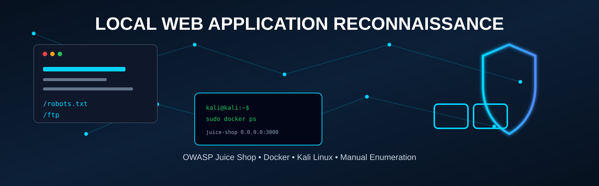

<p align="center">
  
</p>

# Local Web Application Reconnaissance

### OWASP Juice Shop • Docker • Kali Linux • Manual Enumeration

---

**Candidate Name:** Mohammad Shah  
**Track:** Red Team  
**Time Spent:** 1.5 Hours

---

## Objective

For this exercise, I set up a self-hosted OWASP Juice Shop instance using Docker and performed hands-on reconnaissance to better understand the application's structure. The focus was on discovering hidden endpoints and directories through manual exploration rather than automated or intrusive techniques.

---

## Scope & Environment

### Target Environment
- OWASP Juice Shop
- Local Docker Container
- URL: http://localhost:3000

### Tools Used
- Kali Linux
- Docker
- Firefox Browser
- Firefox Developer Tools (Network Tab)

### Scope Limitation

This assessment was performed entirely in a self-hosted environment using synthetic data. No public infrastructure, third-party systems, or real-world data were targeted.

---

## Methodology

### Step 1 – Deploy Application

Pulled and executed the OWASP Juice Shop Docker image:

```bash
sudo docker pull bkimminich/juice-shop
sudo docker run -d -p 3000:3000 --name juice-shop bkimminich/juice-shop
```

Verified successful deployment:

```bash
sudo docker ps
```

### Step 2 – Access Application

Opened the application in Firefox:

```text
http://localhost:3000
```

### Step 3 – Manual Enumeration

Performed manual reconnaissance by:

- Reviewing common files and directories
- Inspecting robots.txt
- Following discovered paths
- Exploring application routes
- Reviewing requests in Firefox Developer Tools

### Step 4 – Developer Tools Analysis

Opened the Network tab and refreshed the application to observe backend requests and API endpoints generated by the application.

---

## Findings / Analysis

### Finding 1 – robots.txt Disclosure

**Endpoint**

```text
/robots.txt
```

**Discovery Method**

Manual URL inspection.

**Evidence**

The robots.txt file contained:

```text
User-agent: *
Disallow: /ftp
```

**Analysis**

The robots.txt file disclosed an additional directory that was not visible through normal navigation. Attackers commonly review robots.txt during reconnaissance to identify hidden resources.

**Risk Level:** Low

---

### Finding 2 – Exposed FTP Directory

**Directory**

```text
/ftp
```

**Discovery Method**

Followed information disclosed within robots.txt.

**Evidence**

The directory listing contained multiple files including:

```text
acquisitions.md
incident-support.kdbx
legal.md
suspicious_errors.yml
```

**Analysis**

The application exposed a file repository that could provide additional information about the system. Publicly accessible directories increase the overall attack surface and may reveal information useful during further reconnaissance.

**Risk Level:** Medium

---

### Finding 3 – Administration Endpoint

**Endpoint**

```text
/#/administration
```

**Discovery Method**

Manual route enumeration.

**Evidence**

The application returned:

```text
403 - You are not allowed to access this page
```

**Analysis**

Although access was denied, the response confirmed the existence of an administrative interface. Administrative endpoints are high-value targets because they provide privileged functionality.

**Risk Level:** Medium

---

### Additional Observation

Using Firefox Developer Tools, several API endpoints were observed, including:

```text
/api/Challenges/?name=Score Board
/api/Quantitys/
/search?q=
```

These requests provided insight into the application's backend structure and exposed functionality.

---

## Recommendation / Remediation

1. Avoid disclosing sensitive directories through robots.txt.
2. Restrict public access to internal repositories such as /ftp.
3. Implement strict authorization controls on administrative functionality.
4. Remove unnecessary files and backups from publicly accessible locations.
5. Monitor and review exposed API endpoints to minimize information disclosure.
6. Conduct regular security reviews to identify exposed resources and reduce attack surface.

### Business Impact

Information disclosure can assist attackers during reconnaissance and increase the likelihood of successful exploitation attempts. Proper access controls and reduction of exposed resources help decrease organizational risk.

---

## 7. Self-Attestation

I self-sourced all materials, used only public/synthetic/self-owned resources, and performed non-destructive work.
